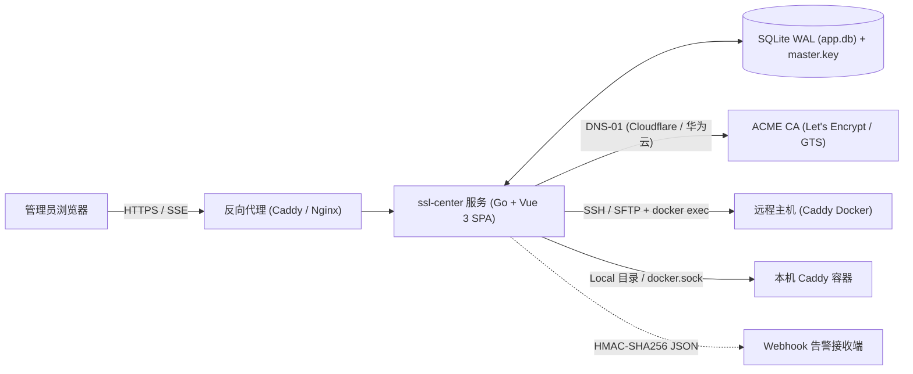

# ssl-center

面向个人、Homelab 与中小规模服务器集群（1~20 台）的轻量级 **ACME SSL 证书签发、纯推送自动化部署与 Caddy Docker 在线运维中心**。

[](https://github.com/saitomikuya/ssl-center/actions/workflows/ci-release.yml)
[](https://hub.docker.com/r/saitomikuya/ssl-center)
[](https://github.com/saitomikuya/ssl-center/pkgs/container/ssl-center)
[](https://go.dev/)
[](LICENSE)

---

## 核心特性

### 1. 单二进制嵌入式部署与双架构镜像
- **零外部依赖运行**：Go 1.26 单二进制内嵌 Vue 3 + TypeScript 前端产物与纯 Go SQLite（WAL 模式，零 CGO），单容器即可运行。
- **双架构支持**：同时提供 `linux/amd64` 与 `linux/arm64` 多架构 Docker 镜像（Docker Hub 与 GHCR），内置 `docker-cli` 与健康检查。

### 2. 多 CA 与多账号 DNS 管理
- **多 CA 支持**：
  - **Let's Encrypt**：支持生产与 Staging 环境，填邮箱即可注册（免 EAB 开箱即用）。
  - **Google Trust Services (GTS)**：支持 EAB（`keyId` + `b64MacKey`）首次注册（参见 [GTS EAB 获取教程](docs/GTS_EAB_GUIDE.md)），注册后立即销毁一次性 EAB 凭据不入库；支持已有 `acme.key` 在线校验导入与导出备份。
- **多账号 DNS-01 鉴权**：
  - 支持 **Cloudflare**（API Token）与 **华为云 DNS**（AK / SK，支持国内版 / 国际版自动匹配 Region 或自定义）多账号命名管理，支持「测试凭据」连通性校验与可见 Zone 拉取。
  - 添加证书时按最长后缀自动匹配对应 Zone（支持手动覆写），写入 `_acme-challenge` TXT 后等待权威/递归传播并在完成后精确清理，Zone 级互斥锁保护同根域与泛域名并发签发。

### 3. 状态驱动自动续期与 6 阶段实时观测
- **智能续期调度**：每日定时巡检（默认 `03:00`），仅续期「尚未签发」或「剩余有效期 ≤ 提前续期天数（默认 30 天）」的证书；支持 `EC256` / `EC384` / `RSA2048` 密钥算法。
- **退避重试与实时进度**：签发失败按 `15m → 1h → 6h` 自动退避重试（3 次上限后触发告警）；6 阶段签发进度（`create_order → write_dns_txt → wait_propagation → ca_validate → save_cert → trigger_deploy`）通过 SSE 实时推送并支持断线自动降级轮询。

### 4. 纯推送部署引擎与 TLS 指纹校验
- **无客户端架构**：无需在目标节点运行常驻 Agent，通过 **SSH/SFTP 原子写入**（同目录临时文件 → 权限设置 → `PosixRename`）或 **内置本机（Local）模式**主动推送 `fullchain.pem` / `privkey.pem`。
- **深度适配 Caddy Docker**：支持 `caddy_docker` / `local_dir` / `custom_ssh` 部署模板，默认执行 `caddy reload --config ... --force`，推送后可发起轻量 TLS 握手校验叶证书 SHA-256 指纹是否真正生效。

### 5. 远程 Caddyfile 在线工作台
- **在线编辑与冲突防护**：集成 CodeMirror 6 编辑器、一键插入已部署证书 `tls` 片段、`409` 外部修改冲突 Diff 提示、`caddy fmt` 格式化与 `caddy validate` 预校验阻断。
- **安全写入与自动回滚**：通过 `docker inspect` 自动探测目录挂载（原子替换）或单文件 bind mount（容器 `/tmp` 预校验 + 原位覆写保留宿主机 inode）；重载失败自动回滚，并保留历史快照对比回滚与容器日志查看。

### 6. 安全架构、Webhook 告警与一键备份恢复
- **凭据加密与脱敏**：主密钥持久化于 `<DATA_DIR>/master.key`（`0600`），所有敏感字段使用 **AES-256-GCM** 加密落盘；动态 `SecretRedactor` 全局脱敏日志与输出，API 永不回显明文密钥。
- **认证与防爆破**：单管理员密码认证（Argon2id + 按来源 IP 登录限流 + `HttpOnly` Session Cookie + `X-CSRF-Token` 校验）。
- **可观测与灾备**：支持 5 类通用 Webhook 事件（HMAC-SHA256 签名 + 3 次重试）、日志定时/手动清理，以及一键 `.tar.gz` 完整备份（含一致性 DB 快照、`master.key`、`certs/` 与 SHA-256 `manifest.json`）与原子校验恢复。

---

## 系统架构



---

## 快速部署

### 一、使用 Docker Compose（推荐）

准备工作目录并创建 `docker-compose.yml`（也可直接使用仓库根目录的 [docker-compose.yml](docker-compose.yml)）：

```yaml
services:
  ssl-center:
    image: saitomikuya/ssl-center:latest
    # 备选 GHCR 镜像：ghcr.io/saitomikuya/ssl-center:latest
    container_name: ssl-center
    restart: unless-stopped
    stop_grace_period: 20s
    ports:
      # 如前置 Caddy/Nginx 反向代理，建议改为 "127.0.0.1:8080:8080"
      - "8080:8080"
    environment:
      TZ: Asia/Shanghai
      DATA_DIR: /data
      LISTEN_ADDR: ":8080"
      # 首次启动可预设管理员密码；留空则自动生成 16 位随机密码并输出到容器日志
      # INIT_PASSWORD: "ChangeMeStrongPass123!"
      # INIT_FORCE_CHANGE: "false"
      # 反向代理 HTTPS 终止时建议开启 TRUST_PROXY: "true"
      # COOKIE_SECURE: "auto"
      # TRUST_PROXY: "false"
      # LOG_LEVEL: "info"
    volumes:
      - ./data:/data
      # 如需使用内置 Local 主机模式管理同宿主机 Caddy 容器，请取消下方注释，
      # 并将宿主机实际的 Caddyfile 所在目录与证书目录以相同路径挂载进容器（读写，否则会提示 file does not exist）：
      # - /var/run/docker.sock:/var/run/docker.sock
      # - /opt/caddy:/opt/caddy
      # - /opt/caddy/certs:/opt/caddy/certs
```

启动服务并查看首次生成的管理员初始密码：

```bash
docker compose up -d
docker compose logs ssl-center | grep "Initial admin password"
```

### 二、使用 Docker CLI

```bash
docker run -d \
  --name ssl-center \
  --restart unless-stopped \
  -p 8080:8080 \
  -e TZ=Asia/Shanghai \
  -v $(pwd)/data:/data \
  saitomikuya/ssl-center:latest

docker logs ssl-center | grep "Initial admin password"
```

### 三、反向代理配置示例

当面板通过 HTTPS 反向代理对外提供服务时，建议在环境变量中设置 `TRUST_PROXY=true`（`COOKIE_SECURE` 保持默认的 `auto` 即可随 `X-Forwarded-Proto` 自动切换 `Secure` Cookie）：

**Caddy：**

```caddyfile
ssl.example.com {
    reverse_proxy 127.0.0.1:8080
}
```

**Nginx（注意关闭缓冲以保证 SSE 签发实时流正常推送）：**

```nginx
server {
    listen 443 ssl http2;
    server_name ssl.example.com;

    location / {
        proxy_pass http://127.0.0.1:8080;
        proxy_http_version 1.1;
        proxy_set_header Host $host;
        proxy_set_header X-Real-IP $remote_addr;
        proxy_set_header X-Forwarded-For $proxy_add_x_forwarded_for;
        proxy_set_header X-Forwarded-Proto $scheme;
        proxy_buffering off;
        proxy_read_timeout 300s;
    }
}
```

---

## 首次部署测试流程（Quickstart）

1. **登录与改密**：访问 `http://<服务器IP>:8080`，使用容器日志输出的初始密码（或 `INIT_PASSWORD`）登录，按提示修改为强密码。
2. **添加 CA 与 DNS 凭据**：进入「凭据管理」添加 Let's Encrypt（推荐先用 Staging 测试）或 GTS 账户，再添加 Cloudflare / 华为云 DNS 凭据并点击「测试凭据」确认可见 Zone 列表。
3. **添加主机与 Caddy 档案**：进入「主机管理」添加目标 SSH 主机（或配置内置 `Local` 主机），填写 Caddy 容器名、宿主机配置路径与容器内挂载路径，点击测试连接验证 SSH/Docker 连通性。
4. **签发证书**：进入「证书管理」新建证书（主域名 + 可选 SAN + 密钥算法），点击「立即签发」即可在抽屉中通过 SSE 实时观察 6 阶段执行日志。
5. **配置部署并校验生效**：为证书添加部署任务（选择主机、证书目录与重载方式），执行推送后可查看远端回显与 TLS 握手指纹校验结果。
6. **在线管理 Caddyfile**：在主机面板打开 Caddy 工作台，拉取现网 `Caddyfile`、一键插入证书 `tls` 片段、运行预校验并热重载，同时保留版本快照支持对比回滚。

---

## 环境变量说明

| 变量名 | 默认值 | 说明 |
| --- | --- | --- |
| `DATA_DIR` | `/data` | 数据根目录（存放 `master.key`、`app.db`、`certs/`、`tmp/`） |
| `LISTEN_ADDR` | `:8080` | HTTP 监听地址（未设置时回退读取 `PORT`） |
| `INIT_PASSWORD` | 空 | 首次初始化管理员密码；留空则自动生成 16 位随机密码并输出至 stdout，首次登录强制改密 |
| `INIT_FORCE_CHANGE` | `false` | 当设置 `INIT_PASSWORD` 时，是否仍要求首次登录强制改密 |
| `COOKIE_SECURE` | `auto` | Session Cookie `Secure` 策略：`auto` / `true` / `false` |
| `TRUST_PROXY` | `false` | 是否信任反代 `X-Forwarded-For` / `X-Real-IP` 解析客户端 IP |
| `LOG_LEVEL` | `info` | 日志级别：`debug` / `info` / `warn` / `error` |
| `TZ` | `Asia/Shanghai` | 时区（用于每日定时巡检时间 `inspect_time` 计算） |

---

## Webhook 告警事件

系统支持配置通用 Webhook（支持自定义 Header 与 `HMAC-SHA256` 签名，失败自动重试 3 次），覆盖以下 5 类核心事件：

| 事件名 | 触发时机 | 默认启用 |
| --- | --- | --- |
| `cert.issue_failed` | 证书签发或续期重试耗尽失败 | 是 |
| `cert.expiring_soon` | 巡检发现证书临近过期且尚未恢复 | 是 |
| `deploy.failed` | 证书推送、重载或 TLS 校验失败 | 是 |
| `caddy.reload_failed` | Caddy 工作台发布重载失败 | 是 |
| `cert.deployed` | 证书成功推送并完成部署 | 否（按需勾选） |

---

## 生产运维提示

1. **DNS 凭据最小权限**：
   - Cloudflare 建议使用仅授予目标域名 `Zone:DNS:Edit` 与 `Zone:Zone:Read` 权限的 API Token。
   - 华为云 DNS 请使用具备 DNS 解析管理权限的 IAM AK/SK，直接选择国内版（自动使用 `cn-north-4`）或国际版（自动使用 `ap-southeast-1`），亦支持按需自定义 Region。
2. **SSH Host Key（TOFU 策略）**：
   - 新建 SSH 主机默认启用 `tofu`（首次信任并锁定公钥指纹）。若目标服务器重装导致指纹变化，系统会主动拦截告警，确认安全后可在主机面板点击「重置指纹」重新信任。
3. **Caddy `--force` 与挂载探测**：
   - 部署模板默认使用 `docker exec '<container>' caddy reload --config '<path>' --force`，确保仅更新证书文件而 `Caddyfile` 文本未变时也能强制加载新证书。
   - Caddy 管理面板会通过 `docker inspect` 自动识别配置挂载类型：目录挂载走同目录临时文件校验 + `PosixRename` 原子替换；单文件 bind mount 自动走容器 `/tmp` 预校验 + 原位覆写以保留宿主机文件 inode。
   - 若在 Docker 中运行 `ssl-center` 并使用内置 `Local` 主机模式管理同宿主机 Caddy 容器，由于 `Local` 模式是在 `ssl-center` 容器自身文件系统内直接读写路径，除 `/var/run/docker.sock` 外，还必须将宿主机实际的 `Caddyfile` 所在目录和证书目录按**相同路径（读写）**挂载进 `ssl-center` 容器，否则拉取配置会提示 `file does not exist`；若不希望挂载宿主机目录与 Docker Socket，也可新建 SSH 主机来管理本机。
4. **备份与恢复**：
   - 导出备份包含 `app.db`（`VACUUM INTO` 一致性快照并清除活跃 `sessions`）、`master.key`、`certs/` 与 `manifest.json`（SHA-256 清单）。
   - 恢复前会自动校验归档路径安全（防 Tar-Slip 与软链接）、SHA-256 完整性、SQLite `integrity_check` 与主密钥试解密，并在全局维护锁保护下备份旧数据至 `<DATA_DIR>/pre_restore_<ts>/` 后原子切换。恢复完成后请使用备份库中的管理员密码重新登录。

---

## 本地开发与源码构建

### 前置依赖
- Go 1.26+
- Node.js 22+ / npm

### 构建与测试

```bash
# 1. 安装前端依赖、类型检查并构建至 internal/web/dist/
make web

# 2. 运行静态检查与竞态测试
make vet
make test

# 3. 编译单二进制（零 CGO）
make build

# 4. 启动服务（开发时可指定临时 DATA_DIR 与端口）
DATA_DIR=./data LISTEN_ADDR=127.0.0.1:8080 ./bin/ssl-center
```

也可直接构建本地 Docker 镜像：`make docker` 或 `make docker-buildx`。

---

## 开源协议

本项目基于 [MIT License](LICENSE) 开源。
